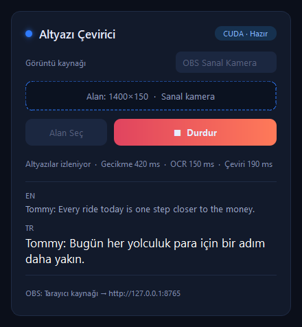

# 🎮 PS5 Altyazı Çevirici

**Oyunlardaki İngilizce altyazıları anlık olarak Türkçeye çeviren, tamamen bilgisayarınızda çalışan ücretsiz bir araç.**

Türkçe dil desteği olmayan bir oyunu oynarken altyazıları anlamakta zorlanıyorsanız bu araç tam size göre. Oyun görüntüsündeki altyazıyı okur, Türkçeye çevirir ve çeviriyi OBS üzerinden oyun görüntüsünün üstüne yazar. İnternet bağlantısı, hesap ya da ücretli bir çeviri servisi gerekmez; her şey sizin bilgisayarınızda, sizin ekran kartınızda çalışır.

<p align="center">
  
</p>

> ⚠️ **Kişisel kullanım içindir.** Çeviri modeli (Meta NLLB-200) yalnızca ticari olmayan kullanıma izin veren CC-BY-NC-4.0 lisansına sahiptir. Ayrıntılar için [Lisans](#-lisans) bölümüne bakın.

---

## 📑 İçindekiler

- [Nasıl çalışır?](#-nasıl-çalışır)
- [Neler gerekiyor?](#-neler-gerekiyor)
- [Kurulum (adım adım)](#-kurulum-adım-adım)
- [PS5'i bağlama (HDMI yakalama kartı)](#-ps5i-bağlama-hdmi-yakalama-kartı)
- [OBS ayarı](#-obs-ayarı)
- [Kullanım](#️-kullanım)
- [İlk test: kurulumunuzu deneyin](#-i̇lk-test-kurulumunuzu-deneyin)
- [Ayarlar](#️-ayarlar)
- [Sorun giderme](#️-sorun-giderme)
- [Sık sorulan sorular](#-sık-sorulan-sorular)
- [Proje yapısı](#️-proje-yapısı)
- [Lisans](#-lisans)

---

## 🔍 Nasıl çalışır?

```
 PS5 ─HDMI─▶ Yakalama kartı ─USB─▶ OBS ──Sanal Kamera──▶ Uygulama ──▶ OBS Tarayıcı kaynağı
                                                         │  OCR + çeviri      (oyunun üstünde
                                                         │  "Stay close."      Türkçe altyazı)
                                                         ▼  "Yakın dur."
```

1. **Görüntü:** Uygulama oyun görüntüsünü **OBS Sanal Kamera** üzerinden tam 1080p olarak alır. Ekrandaki pencereler araya giremez. İsterseniz ekranın bir bölgesini okuyan "Ekran" kaynağını da seçebilirsiniz.
2. **Değişim kontrolü:** Saniyede yaklaşık 20 kez altyazı bölgesine bakılır. Yazı değişmediyse hiçbir şey yapılmaz; arkadaki oyun sahnesinin hareket etmesi bu kontrolü tetiklemez, yalnızca yazının kendisi takip edilir.
3. **Metin tanıma (OCR):** Yazı değiştiyse görüntü temizlenir (beyaz yazı arka plandan ayrılır), yazının çevresinden kırpılır, en iyi okunan boyuta ölçeklenir ve [Tesseract](https://github.com/tesseract-ocr/tesseract) ile okunur. Tesseract'ın emin olmadığı kelimeler atılır; böylece altyazı yokken arka plandaki nesneler "altyazı" sanılmaz.
4. **Çeviri:** Metin, Meta'nın [NLLB-200](https://huggingface.co/facebook/nllb-200-distilled-600M) modeliyle hemen Türkçeye çevrilir. `Kratos: Stay close.` gibi konuşmacı adı içeren satırlarda yalnızca konuşma çevrilir. Harf harf beliren altyazılarda çeviri, yazı uzadıkça güncellenir.
5. **Gösterim:** Çeviri, OBS'teki **Tarayıcı kaynağına anında** gönderilir. Her çeviri en az 1,5 saniye ekranda kalır; hızlı geçen bir altyazının ardından yenisi gelirse önceki çeviri onun üstünde soluk olarak bir süre daha görünür. Altyazı oyundan kaybolunca çeviri de silinir.

**Hız:** Bir NVIDIA ekran kartında, altyazının oyunda belirmesinden çevirinin ekranda görünmesine kadar geçen süre genellikle **0,35 – 0,65 saniyedir**. Ekranda yarım saniye kalan "Run!" gibi kısa altyazılar da yakalanır. Uygulama penceresindeki **Gecikme** değeri bu süreyi canlı gösterir.

---

## 🧰 Neler gerekiyor?

| Gereksinim | Açıklama |
|---|---|
| **Windows 10 / 11** | Uygulama Windows için geliştirildi ve test edildi. |
| **Python 3.10 veya üzeri** | Python 3.13 ile test edildi. |
| **Tesseract OCR** | Ekrandaki yazıyı okuyan ücretsiz program. |
| **OBS Studio** (28 veya üzeri) | Oyun görüntüsünü almak ve çeviriyi göstermek için. |
| **HDMI yakalama kartı** | PS5 görüntüsünü bilgisayara almak için. Bkz. [PS5'i bağlama](#-ps5i-bağlama-hdmi-yakalama-kartı). |
| **NVIDIA ekran kartı** *(önerilir)* | Ekran kartı olmadan da çalışır ama çeviri birkaç kat yavaşlar. |
| **~3 GB boş disk alanı** | Çeviri modeli yaklaşık 2,5 GB yer kaplar. |

---

## 📦 Kurulum (adım adım)

Aşağıdaki adımları sırayla izleyin. Komutları **PowerShell** ya da **Komut İstemi**'ne yapıştırabilirsiniz.

### 1. Python'u kurun

[python.org/downloads](https://www.python.org/downloads/) adresinden en güncel Python'u indirin.

> 💡 Kurulumun ilk ekranında **"Add python.exe to PATH"** kutusunu mutlaka işaretleyin.

Kurulumun çalıştığını şu komutla kontrol edebilirsiniz:

```bash
python --version
```

### 2. Tesseract OCR'yi kurun

1. [Tesseract'ın Windows sürümünü](https://github.com/UB-Mannheim/tesseract/wiki) indirin (`tesseract-ocr-w64-setup-...exe`).
2. Kurulumu varsayılan ayarlarla tamamlayın. Program şu klasöre kurulur:
   `C:\Program Files\Tesseract-OCR\`
3. İngilizce dil paketi varsayılan olarak gelir; başka bir şey seçmenize gerek yok.

> Tesseract'ı farklı bir klasöre kurduysanız, yolunu daha sonra [ayarlar](#️-ayarlar) dosyasına yazmanız yeterli.

### 3. Projeyi indirin

Git kullanıyorsanız:

```bash
git clone https://github.com/GokhanGuclu/ps5-altyazi-cevirici.git
```

Git kullanmıyorsanız bu sayfanın üstündeki yeşil **Code** düğmesine basıp **Download ZIP** ile indirin ve klasörü bir yere çıkarın.

Sonra proje klasörüne girin:

```bash
cd ps5-altyazi-cevirici
```

### 4. Python paketlerini kurun

```bash
python -m pip install -r requirements.txt
```

Bu adım birkaç dakika sürebilir.

### 5. Ekran kartı desteğini açın (NVIDIA kullanıyorsanız)

`pip`'in kurduğu PyTorch çoğu zaman yalnızca işlemcide (CPU) çalışan sürümdür. Ekran kartınızı kullanmak için CUDA destekli sürümü kurun:

```bash
python -m pip install torch --index-url https://download.pytorch.org/whl/cu128
```

> Ekran kartınıza ve sürücünüze uygun komutu [pytorch.org/get-started](https://pytorch.org/get-started/locally/) sayfasındaki seçiciden de alabilirsiniz.

Kontrol etmek için şu komutu çalıştırın. Sonuç `True` ise ekran kartı kullanılacak demektir:

```bash
python -c "import torch; print(torch.cuda.is_available())"
```

### 6. Çeviri modelini indirin

Modeli bir kez indirip bilgisayarınızda saklamak en hızlı ve sorunsuz yoldur:

```bash
hf download facebook/nllb-200-distilled-600M --local-dir "C:\AI-Models\nllb-200"
```

> Bu adımı atlarsanız model, uygulama ilk açıldığında otomatik olarak indirilir. Modeli başka bir klasöre indirdiyseniz yolunu [ayarlar](#️-ayarlar) dosyasındaki `model` alanına yazın.

### 7. Uygulamayı başlatın

```bash
python cevirici_gui.py
```

🎉 Kurulum tamamlandı! Sıradaki adım PS5'i bağlamak ve OBS'i ayarlamak.

---

## 🎮 PS5'i bağlama (HDMI yakalama kartı)

```
PS5 ──HDMI──▶ Yakalama kartı ──USB──▶ Bilgisayar ──HDMI──▶ TV / Monitör
                                     (OBS: oyun + Türkçe altyazı)
```

Oyunu bilgisayar üzerinden TV'de oynarsınız: TV, bilgisayarın ikinci ekranı olur ve OBS oyunu altyazıyla birlikte tam ekran gösterir.

**Kart seçerken:**
- **USB 3.0** ve **1080p 60fps** desteği olmalı. USB 2.0 kartlar görüntüyü sıkıştırır; TV'deki görüntü bulanıklaşır.
- İçinde **MS2130** çipi olan ucuz kartlar bu iş için yeterlidir (ör. *VegGieg V-Z632*, bu projeyle test edildi).
- ⚠️ **"USB-C → HDMI"** çeviriciler ve **USB-C hub**'lar yakalama kartı **değildir**: görüntüyü dışarı verirler, içeri alamazlar. Kutuda **"Video Capture"** yazmalı.
- Takınca Windows'ta kamera olarak görünür (ör. "V-Z632" ya da "USB Video").

**PS5 ayarları** (*Ayarlar → Ekran ve Video*):
- **Çözünürlük: 1080p**
- **HDR: Kapalı** (kartlar HDR aktarmaz; açık kalırsa renkler soluk görünür)
- Görüntü siyah gelirse: *Ayarlar → Sistem → HDMI → **HDCP'yi Etkinleştir**: Kapalı*

**Oyun ayarlarında** (OCR'nin daha iyi okuması için):
- **Altyazı: Açık**, **boyut: Büyük**
- **Altyazı arka planı: Açık** (varsa; en büyük farkı bu yaratır)

> ℹ️ **PS Remote Play** görüntüsü korumalıdır ve yakalama yazılımlarına siyah görünür. Bu yüzden Remote Play ile çalışmaz; yakalama kartı gerekir.

---

## 📺 OBS ayarı

### 1. Oyun görüntüsü
1. **Kaynaklar → + → Video Yakalama Aygıtı** → yakalama kartınızı seçin.
2. Kaynağa sağ tık → **Özellikler**: **Çözünürlük/FPS Türü: Özel**, **1920x1080**, **60 FPS**, **Video Biçimi: YUY2**.

### 2. Oyun sesi
1. **Kaynaklar → + → Ses Girişi Yakalama** → kartın ses aygıtını seçin (ör. *Dijital Ses Arabirimi (V-Z632)*).
2. Ses karıştırıcıda **⚙ → Gelişmiş Ses Özellikleri** → bu kaynağın **Ses İzleme** ayarını **"Ekran ve Çıkış"** yapın.
3. **Masaüstü Ses** satırını **"Ekran Kapalı"** bırakın, yoksa yankı olur.

### 3. Sanal kamera (uygulamanın görüntüyü alacağı yer)
1. OBS'in sağ alt köşesindeki **Sanal Kamerayı Başlat** düğmesine basın.
2. Yanındaki **⚙** düğmesine basın → **Çıktı Türü: Kaynak** → **Video Yakalama Aygıtı**.
   Böylece uygulama yalnızca oyun görüntüsünü görür, OBS'te üste eklediğiniz Türkçe altyazıyı değil.

### 4. Türkçe altyazı
1. **Kaynaklar → + → Tarayıcı** → URL: **`http://127.0.0.1:8765`**, **Genişlik 1920**, **Yükseklik 1080**.
2. Kaynak listesinde **Tarayıcı** kaynağının **Video Yakalama Aygıtı**'nın **üstünde** olduğundan emin olun.
3. Yazı boyutunu ve konumunu URL ile ayarlayabilirsiniz: `http://127.0.0.1:8765/?size=52&bottom=18`
   - `size`: yazı boyutu (piksel, varsayılan 46)
   - `bottom`: alttan uzaklık (ekran yüksekliğinin yüzdesi, varsayılan 14)

> Tarayıcı kaynağı, çeviriyi beklemeden anında gösterir. Eski **Metin (GDI+) → Dosyadan oku → `altyazi.txt`** yöntemi de çalışır, ancak OBS dosyayı saniyede bir kontrol ettiği için kısa altyazıları kaçırabilir.

### 5. TV'de tam ekran
Önizlemeye sağ tık → **Tam Ekran Projektör** → TV'yi seçin. TV'yi **Oyun Modu**'na almayı unutmayın.

---

## 🕹️ Kullanım

1. OBS'te **Sanal Kamerayı Başlat**'a basılı olduğundan emin olun.
2. `python cevirici_gui.py` ile uygulamayı açın. **Görüntü kaynağı: OBS Sanal Kamera** seçili olsun.
3. Oyunda altyazının göründüğü bir sahneye gelin ve **Alan Seç**'e basın. Oyun görüntüsünden bir kare açılır.
4. Fareyle **altyazının çıktığı bandı** çizin:
   - Soldan sağa, en uzun altyazıyı alacak kadar geniş tutun.
   - Yüksekliği iki satır yazıyı alacak kadar tutun.
   - Vazgeçmek için **ESC**'ye ya da **sağ tık**'a basın.
   - OBS logosu görüyorsanız sanal kamera başlatılmamıştır.
5. **▶ Başlat**'a basın. İlk açılışta model yaklaşık 20 saniyede yüklenir; rozet **"CUDA · Hazır"** olunca pencere kendiliğinden küçülür.
6. Oynayın! İşiniz bitince pencereyi açıp **■ Durdur**'a basın ya da kapatın.

Seçtiğiniz alan kaydedilir; bir sonraki açılışta doğrudan **Başlat**'a basabilirsiniz.

---

## 🧪 İlk test: kurulumunuzu deneyin

Oyunu bağlamadan önce kurulumunuzun çalıştığını görmek için projeyle birlikte bir test sayfası gelir:

1. `test_altyazi.html` dosyasına çift tıklayıp tarayıcıda açın, **F11** ile tam ekran yapın.
2. Uygulamada **Görüntü kaynağı: Ekran** seçin, **Alan Seç** ile altyazı bandını çizin ve **Başlat**'a basın.
3. Pencerede **EN** satırında İngilizce metni, **TR** satırında çevirisini görmelisiniz:

| EN | TR |
|---|---|
| Kratos: Stay close, boy. | Kratos: Yakın dur, evlat. |
| We need to leave before the guards come back. | Muhafızlar dönmeden gitmeliyiz. |
| Atreus: Father, look! There is something in the water. | Atreus: Baba, bak, suda bir şey var. |

---

## ⚙️ Ayarlar

Uygulama ayarlarını proje klasöründeki `ayarlar.json` dosyasında tutar. Bu dosya ilk alan seçiminde otomatik oluşturulur. Örnek için [`ayarlar.example.json`](ayarlar.example.json) dosyasına bakın.

| Ayar | Varsayılan | Ne işe yarar? |
|---|---|---|
| `source` | `camera` | Görüntü kaynağı: `camera` (OBS Sanal Kamera) ya da `screen` (ekran bölgesi). Arayüzden seçilir. |
| `camera` | `OBS Virtual Camera` | Okunacak kameranın adı. Yakalama kartını doğrudan okumak için kartın adını yazabilirsiniz (OBS kartı kullanmıyorsa). |
| `camera_region` / `region` | — | Seçilen altyazı alanı. **Alan Seç** ile otomatik yazılır. |
| `tesseract` | `C:\Program Files\Tesseract-OCR\tesseract.exe` | Tesseract'ın yolu. Bulunamazsa sistem `PATH`'inde aranır. |
| `model` | `C:\AI-Models\nllb-200` | Çeviri modelinin klasörü. Klasör yoksa model HuggingFace'ten indirilir. |
| `text_mode` | `light` | Altyazının rengi: `light` (beyaz/açık yazı — çoğu oyun), `dark` (koyu yazı), `none` (görüntü temizleme kapalı). |
| `threshold` | `170` | Yazıyı arka plandan ayırma eşiği (0–255). |
| `min_confidence` | `60` | Tesseract'ın bu puanın altında okuduğu kelimeler atılır (0–100). |
| `overlay_port` | `8765` | OBS Tarayıcı kaynağının adresindeki port. |

**`threshold` nasıl ayarlanır?**
- Altyazı **okunmuyor** ya da eksik okunuyorsa → değeri **düşürün** (ör. `140`).
- Arka plandaki parlak nesneler **anlamsız harfler** olarak okunuyorsa → değeri **yükseltin** (ör. `200`).

Ayarı değiştirdikten sonra uygulamayı yeniden başlatın.

---

## 🛠️ Sorun giderme

<details>
<summary><b>"OBS Virtual Camera bulunamadı" ya da alan seçerken OBS logosu görünüyor</b></summary>

OBS açık değil ya da sanal kamera başlatılmamış. OBS'in sağ altındaki **Sanal Kamerayı Başlat** düğmesine basın. OBS 28 veya üzeri gerekir.
</details>

<details>
<summary><b>Çeviri OBS'te görünmüyor</b></summary>

- Tarayıcı kaynağının URL'si `http://127.0.0.1:8765` mi? Uygulama penceresinin altında doğru adres yazar.
- Tarayıcı kaynağı, kaynak listesinde oyun görüntüsünün **üstünde** mi?
- Uygulama **Başlat**'a basılmış ve rozet **Hazır** mı?
- Uygulama iki kez açıksa ikincisi bu adresi kullanamaz; birini kapatın.
</details>

<details>
<summary><b>Kendi Türkçe altyazımı tekrar okuyup çeviriyor</b></summary>

Sanal kamera tüm sahneyi (üstteki Türkçe altyazıyla birlikte) gönderiyor. Sanal kameranın **⚙ → Çıktı Türü** ayarını **Kaynak → Video Yakalama Aygıtı** yapın.
</details>

<details>
<summary><b>"Tesseract bulunamadı" hatası alıyorum</b></summary>

Tesseract kurulu değil ya da farklı bir klasörde. [2. adımdaki](#2-tesseract-ocryi-kurun) gibi kurun veya `ayarlar.json` içindeki `tesseract` alanına `tesseract.exe` dosyasının tam yolunu yazın. Yolda ters eğik çizgileri ikişer yazmayı unutmayın:

```json
"tesseract": "D:\\Programlar\\Tesseract-OCR\\tesseract.exe"
```
</details>

<details>
<summary><b>Rozette "CPU" yazıyor, çeviri yavaş</b></summary>

PyTorch'un ekran kartı destekli sürümü kurulu değil. [5. adımdaki](#5-ekran-kartı-desteğini-açın-nvidia-kullanıyorsanız) komutu çalıştırın. NVIDIA sürücünüzün güncel olduğundan da emin olun.
</details>

<details>
<summary><b>EN satırı boş kalıyor, hiçbir şey okunmuyor</b></summary>

- Seçtiğiniz alanın altyazıyı tamamen kapsadığından emin olun. Alanı yeniden, biraz daha geniş seçin.
- `threshold` değerini düşürün (ör. `140`).
- Oyununuzun altyazıları koyu renkliyse `text_mode` değerini `dark` yapın.
- Oyunda altyazı boyutunu büyütün ve varsa altyazı arka planını açın.
</details>

<details>
<summary><b>EN satırında anlamsız karakterler çıkıyor</b></summary>

Arka plandaki parlak alanlar yazı sanılıyor. `threshold` değerini yükseltin (ör. `200`), alanı yalnızca altyazı bandını kapsayacak şekilde daraltın ya da `min_confidence` değerini yükseltin (ör. `75`).
</details>

<details>
<summary><b>Model yüklenirken "huggingface-hub" ile ilgili bir hata alıyorum</b></summary>

`hf` komut satırı aracı bazen `huggingface-hub` paketini, `transformers` 4.x ile uyumsuz bir sürüme (1.0 ve üzeri) yükseltir. Uyumlu sürüme dönmek için:

```bash
python -m pip install "huggingface-hub>=0.34,<1.0"
```
</details>

<details>
<summary><b>Yakalama kartı Windows'ta görünmüyor</b></summary>

Elinizdeki cihaz bir USB-C hub ya da HDMI çevirici olabilir; bunlar görüntü yakalayamaz. Gerçek bir yakalama kartı, takıldığında Windows'un **Kamera** uygulamasında ayrı bir kamera olarak görünür.
</details>

---

## ❓ Sık sorulan sorular

**İnternet bağlantısı gerekiyor mu?**
Yalnızca kurulum ve modelin ilk indirilmesi için. Sonrasında uygulama tamamen çevrimdışı çalışır; hiçbir metin dışarı gönderilmez. Tarayıcı kaynağının adresi yalnızca bu bilgisayardan erişilebilir (`127.0.0.1`).

**Hangi dillerden çeviri yapıyor?**
Şu an yalnızca İngilizceden Türkçeye. NLLB-200 modeli 200 dili desteklediği için ileride başka diller de eklenebilir.

**Çeviri kalitesi nasıl?**
Günlük konuşma dilindeki kısa cümlelerde oldukça iyi. Oyuna özgü terimlerde, isimlerde ve çok uzun cümlelerde hatalar olabilir. Çevrimdışı ve anlık çalışan bir model için iyi bir denge sunar.

**Oyunu yavaşlatır mı?**
Hayır. PS5 kendi donanımında çalışır; bilgisayar yalnızca altyazı değiştiğinde OCR ve çeviri yapar.

**Mac veya Linux'ta çalışır mı?**
Kod büyük ölçüde platformdan bağımsızdır ama yalnızca Windows'ta test edildi. Sanal kamera araması Windows'a özgüdür.

---

## 🗂️ Proje yapısı

```
ps5-altyazi-cevirici/
├── cevirici_gui.py        # Arayüz (PySide6): kontrol paneli ve alan seçiciler
├── motor.py               # Motor: görüntü alma, OCR, çeviri, gösterim
├── overlay.py             # OBS Tarayıcı kaynağı için altyazı sayfası (anlık gösterim)
├── test_altyazi.html      # Kurulumu denemek için test sayfası
├── ayarlar.example.json   # Örnek ayar dosyası
├── requirements.txt       # Python paketleri
├── docs/                  # README görselleri
└── LICENSE
```

Çalışma sırasında oluşan `ayarlar.json` ve `altyazi.txt` dosyaları kişiseldir ve depoya eklenmez.

---

## 🤝 Katkıda bulunma

Hata bildirimleri, öneriler ve katkılar memnuniyetle karşılanır! Bir sorunla karşılaşırsanız [Issues](https://github.com/GokhanGuclu/ps5-altyazi-cevirici/issues) bölümünde bildirebilirsiniz. Bildirirken şunları eklemeniz çok yardımcı olur:

- Uygulama penceresinin ekran görüntüsü (rozet ve Gecikme / OCR / Çeviri süreleriyle birlikte)
- Hangi oyunu oynadığınız ve yakalama kartınızın modeli
- `ayarlar.json` içindeki `text_mode`, `threshold` ve `min_confidence` değerleri

---

## 📄 Lisans

- **Kaynak kod:** [MIT Lisansı](LICENSE). Kodu dilediğiniz gibi kullanabilir, değiştirebilir ve paylaşabilirsiniz.
- **Çeviri modeli:** [facebook/nllb-200-distilled-600M](https://huggingface.co/facebook/nllb-200-distilled-600M), Meta tarafından **CC-BY-NC-4.0** lisansıyla yayımlanmıştır. Yalnızca **ticari olmayan** kullanıma izin verir. Model bu depoda dağıtılmaz; kurulum sırasında doğrudan HuggingFace'ten indirilir.
- **Tesseract OCR:** Apache 2.0 lisanslıdır.

---

<p align="center">
  Türkçe oynamak isteyen oyuncular için ❤️ ile yapıldı.
</p>
